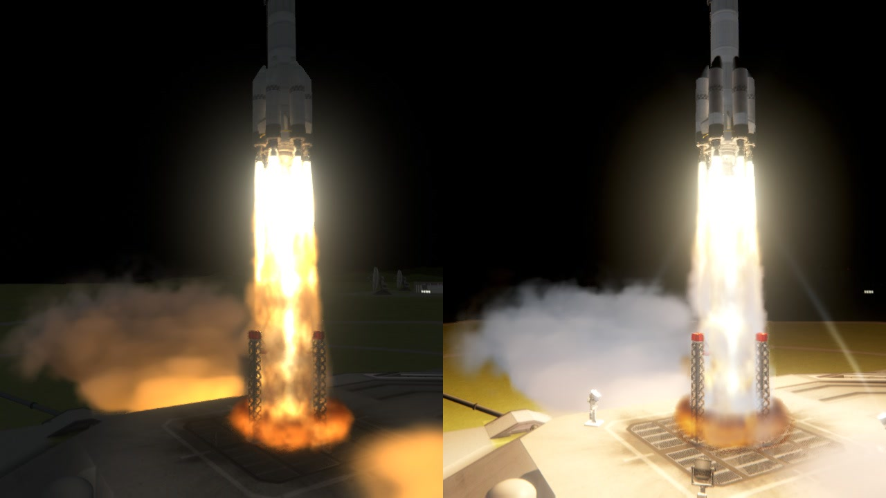
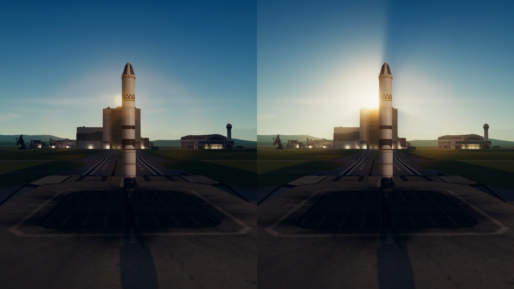
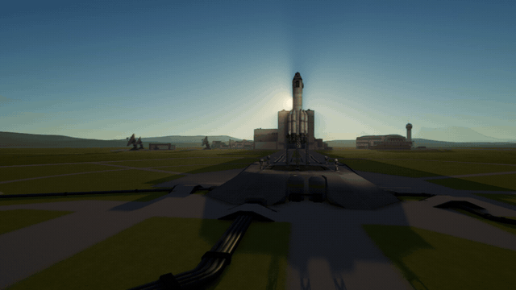

# Natural Light

Light in Kerbal Space Program as it really falls: from the sky, the ground and other worlds, from engines,
floodlights and lit windows by night, with dark nights and long evening shadows. With TUFX installed the picture is
also developed as a film camera would develop it: bright things glow instead of going blank white, and the camera's
eye follows the brightness of the view.

*Left: the game's own picture. Right: with the mod, at the same moment.*

For Kerbal Space Program 1.12.x. **Needs [Keystone](https://github.com/IshiakiZ/ksp-keystone) 0.9 or later**, a separate download
([on SpaceDock](https://spacedock.info/mod/4665/Keystone)): this mod does not load without it. The film look needs
[TUFX](https://github.com/KSPModStewards/TUFX); everything else works without it.

## What it does

* **Light from all round:** the sky in the colour of the planet's air, the ground in its own colour, the Mun by
  night, Kerbin over the Mun. What stands near the craft shades it and lights it.
* **By night:** engines light the craft and the ground, launch sites have floodlights and runway lamps, and the space
  centre's windows throw their light on the ground.
* **Shafts of sunlight** round whatever stands in front of the sun, a deep sky of nebulae and coloured stars, and a
  cabin and a ground crew lit by where they are.
* **Weather in the light,** with Natural Weather: dim under cloud, the distance veiled by rain, fog and dust.
* **Eclipses and cloud tops** (0.12.0): another world before the sun dims the day (the Mun over Kerbin; Kerbin's copper shadow at
  the Mun); over a cloud deck a craft is lit from below by the bright tops; a craft's lamps show their beams in fog and rain;
  red lamps on the space centre's tall buildings by night; aeroplanes' wingtip, tail and strobe lights.
* **A film look** (with TUFX): a film curve, glow, and an exposure that opens in the dark and shuts for anything
  bright.

## Install

Copy the `NaturalLight` folder from the download into your KSP's `GameData`, beside `Keystone`. It is on as installed.

## Settings

In the Keystone window: the keystone button on the game's toolbar, or Alt-K (Option-K on a Mac). Each part can be
turned down or off by itself. [What each one does](https://github.com/IshiakiZ/ksp-natural-light/wiki/Settings).

## Good to know

* **Nights are dark,** as they are. "Darkest" raises them.
* It works beside Scatterer and EVE. Do not use it with PlanetShine or another mod that sets the game's ambient light.
* Its film look is a layer over whatever TUFX profile is in use: with a profile that has a film curve or strong
  grading of its own, turn one of the two off.

## Works on

Mac: tried. Windows 11 (Direct3D 11 and OpenGL): 0.10.2 tried; this version run on both on 2026-10-20 (its shaders loaded, on through
every look of that day's checks), its own looks not tried there. Linux: never run.

**More:** [the long description](https://github.com/IshiakiZ/ksp-natural-light/wiki/The-long-description) (everything in full, more
pictures, and what was tried on each system) and the rest of the [wiki](https://github.com/IshiakiZ/ksp-natural-light/wiki).

## Licence

[CC BY 4.0](LICENSE): use it, change it and pass it on as you like, as long as you credit Ishiaki and link back here.
