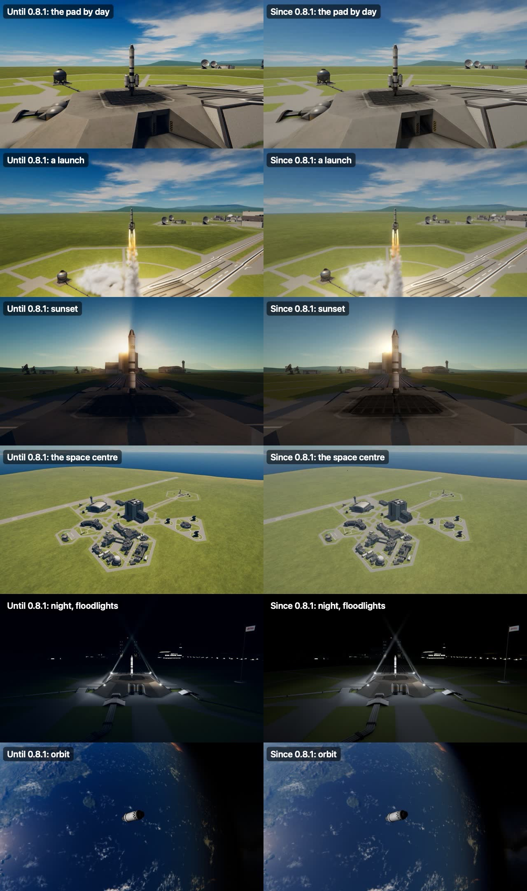
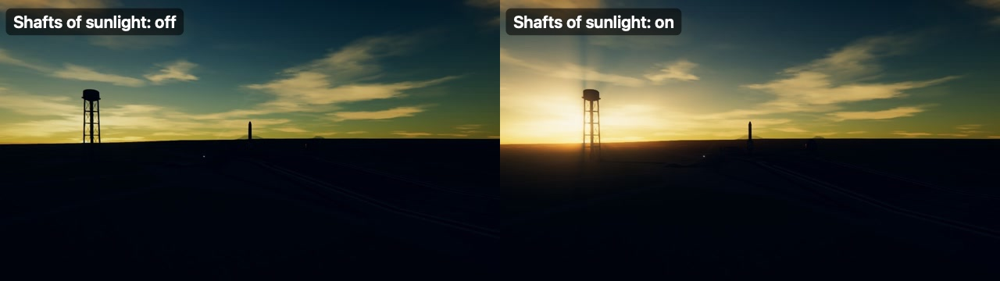

# How it works

## What the game does

In flight the game has one sun, and one "ambient" colour for whatever the sun does not reach: a flat grey,
the same from every direction. It is 0.24 (of full brightness, as shown) in air and 0.06 in a vacuum, by
night as by day. Nothing else gives light: not the sky, not the ground, not an engine's flame.

Two things the game's shaders can do are never used by it, and this mod is built on them:

* They take ambient light that **differs with direction** (it was tried: with blue set from one side and
  red from the other, a rocket takes the two colours on its two sides).
* They take **lamps of a cheap kind**, worked out at the corners of what they light instead of at every
  dot of it, four at a time for each thing drawn, at no cost worth the name. On the pad at night such a
  lamp is hard to tell from the costly kind.

## The light from all round

Every frame, for the place the craft being flown is at, the light arriving from every direction is added
up into what Unity calls an ambient probe (nine numbers a colour) and given to the two cameras that draw
the scene the craft is in. Into it go:

* **The sky**, where the craft is in air: partly from straight up and partly from all round the horizon,
  so that an upright wall gets three fifths of what level ground gets, and what faces down gets little.
  Its colour is worked out from the three wavelengths the game itself draws that planet's sky from: air
  scatters short waves more than long ones, by the fourth power, and what it scatters is what lights the
  shade. So shade on Kerbin is faintly blue, on Duna faintly rust. It is as strong as the air is thick and
  the sun is high: on level ground at noon as bright as the game's flat light was on everything, half
  that with the sun at sixteen degrees, and fading through twilight until the sun is thirteen degrees
  under.
* **The sky's warm side.** With the sun low, the sky on the sun's side is lit by light that has come a
  long way through the air and lost its blue; it goes on glowing for a while after the sun has gone.
* **The ground**, from straight down and from a little below level all round: in the ground's own colour
  (below), as bright as the sun is on that ground and in the colour the sunlight has by then, and filling
  as much of the view below as the planet does from that height. From orbit a body with air is brighter
  than its ground: the air and clouds add about a sixth of the sunlight on their own account.
* **Every other world in the sky**, from its own direction, in the mean colour of its picture: by how much
  of the sky it takes up, how much of its lit side is turned this way, and how strong the sun is out
  there. From Kerbin the full Mun gives a fifty-thousandth of daylight. That is nothing on a screen, so
  when the sun is gone and the sky is dark the light is turned up as an eye turns itself up, far enough
  that a full Mun lights what faces it about as well as the game's flat light did, and it turns cold and
  silver, because an eye in the dark sees blue best. Jool over Laythe needs no such help.
* **The least there ever is**, from everywhere, so that a night side is dark and not black.

The planets seen from afar, the insides of cockpits and the crew's portraits are drawn by other cameras
and keep the game's own light.

## The sun

The game's sun is white and of one strength whatever it shines through. Three things are done to it.

* **Its colour through the air.** Where Scatterer is installed and set to dim and redden a low sun, that
  is left to Scatterer. Where nothing does it, this mod does: by how much air the sunlight has come
  through (Kasten and Young's rule for a low sun), taking out most what the sky is the colour of.
* **The eye keeps pace.** A sun dimmed by the air leaves a scene that is simply darker, and on a screen
  that reads as murk. A camera, or an eye, opens up instead. So the sun is turned back up by most of what
  the air took from it (by how bright the remainder looks, held back so that an evening sun's red is
  never pushed past full), and the sky with it. To know how much Scatterer took, the cameras are asked at
  the moment of drawing what colour they find the sun to be, against what it was set to.
* **Its shadows.** The game lets a quarter of the sunlight through every shadow. With real light in the
  shade that is not needed, and the shadows are made complete.
* **What the clouds leave of it** (with a weather mod; see [weather](#weather)). Since 0.10.0 given as the
  sun's strength, at the moment the scene's cameras draw, and given back for every other camera; not as its
  colour. Scatterer, where it dims and reddens a low sun itself, puts a colour of its own on the sun just
  before those cameras draw, one it kept from when the scene began: set to black under an overcast, the sun
  was found at (1.15, 0.86, 0.46) as the cameras drew, and shone through any overcast at full strength
  (0.9.0's cloud light did nothing to the sun wherever Scatterer was installed). The game sets the strength
  afresh every frame, so it is taken as the game left it, once a frame.

## Engines

A flame is long and wide, and one lamp is a point: a lamp under a rocket lights the pad and, at a grazing
angle, next to nothing of the rocket. What lights the sides of a real rocket at night is the width of its
flame and, far more, the ground under it, lit white-hot and throwing that back up from all round. So each
flame is made of:

* one lamp of the costly kind where it leaves the engine (the engine's bell, the pad, the highlights);
* three of the cheap kind round the flame, a third of the way down it and as far out as it is wide;
* three more round the place where the flame meets the ground, when it does: the ground's own glow, which
  fades as the craft climbs out of reach.

Brightness goes by thrust and by what is burnt (solid fuel burns brightest, a jet dimmest), colour by the
propellant: orange for fuel and oxidiser, near white for solid fuel, blue for xenon. Engines within six
metres of one another share a flame, there are never more than three flames, and all of it flickers.

## Smoke

(The weather's own drops, flakes and blowing dust, Natural Weather's, light themselves by the scene's light as they are
drawn: their materials are named "NaturalWeather..." and left alone here. Taken for smoke, they read dark in any light.)

The game draws its smoke in one brightness whatever light falls on it: an engine's trail and the cloud at
a launch are as white at midnight as at noon, which among dark ground and a rocket lit only by its own
flame looks pasted on. The game's smoke shaders have a tint, and the mod sets it, for each source of smoke,
by the light where that source is: the sun as it reaches the craft (gold at sunrise, nothing at night),
the sky and the ground from all round, a flame by how near it is, and a launch site's floodlights. Full
day leaves the smoke exactly as the game has it; a flame or a lamp shows on it by as much as the day has
gone. The tint is set for each drawing and not in the game's materials, so nothing is left changed when
the mod is switched off.

It is found by its shader: the game's own particle shaders that draw over what is behind them (flames and
sparks are added to what is behind them, and are their own light). Twice a second the scene is looked
through for new ones.

## Launch sites

Every place a craft can be rolled out to (the pad, the runway's ends, the island airfield, and the other
sites the game and its expansions have) gets four floodlights round it, and one weak wide light above the
middle for what four lamps do to damp night air. They come on one after another as the sun reaches the
horizon, and go out at dawn. Only sites within three and a half kilometres of the craft have them.

**The searchlights.** Asked for as: "with the spotlights, have it actually have spotlight models". Each
floodlight is a thing that stands there, by day as well as by night: a xenon searchlight of the kind that
lit the Apollo and Shuttle pads (banks of them, twenty kilowatts each): a round projector head a metre
across of grey-painted cast aluminium, with its front glass, the faceted reflector and the short-arc lamp
seen behind the glass, cooling fins round its back and handles to aim it by; on a yoke over a pan bearing,
with a hand wheel to lock its tilt; on a square steel post with the lamp's ballast box on its back (louvres,
a rating plate, a high-voltage sign without words) and its cable up the post to the yoke; bolted to a
concrete footing. The top of the head is about three metres up when it is turned up at a rocket. (The model
is made with a head 0.8 metres across and drawn a quarter as big again: a big unit of its kind, and one that
can be made out from where the game's camera usually is.)

It is made in Blender by a script kept with the mod (`Model/floodlight.py`: nothing downloaded, no model file
kept by hand), which bakes the shading of its folds (ambient occlusion), its dust and the gloss of each part
into one picture, and the fine relief (the casting's grain, the louvres, the concrete's pores) into a normal map,
and writes its meshes in a small file of the mod's own (`floodlight.mesh`; the same layout as On Foot's tug's,
read by Natural Light's own reader). It is drawn with the game's own part shaders, so the sun, the sky, the
ground and every lamp light it as they light everything else, and it throws a shadow (by day: there is no sun's
shadow to throw by night). About 12,000 triangles (5,500 for the post, 6,500 for the head). A site's four bodies
are joined into one mesh where they stand and drawn at once; what glows in each head (the reflector, the lamp,
the glass) is drawn apart, a mesh for each head, so that each lamp strikes on its own. All of it is in one
frame, the site's, and drawn from one place (see "One frame" below). They have no colliders: nothing a craft could
hit, wherever some other mod's site puts them. Measured by night on the pad with the frame-rate cap lifted,
with the twelve round the pad and the runway near: about half a thousandth of a second a frame of 20 (0.2 to
0.9 in nine measurements, drawn and not drawn in turn); joining the bodies and leaving out their shadows by
night did not bring that down by as much as the measurement can tell.

(The game's emissive shader reads its glow's picture through a mesh's second set of coordinates, it seems: the
reflector, whose glow is its own picture, did not glow at all until its mesh was given the same coordinates
twice, while the lamp, whose glow is a flat white, did.)

The post is turned to face the site and the head tilted up on its yoke to point where the beam goes. The
light comes out of the glass: a lamp of the cheap kind a metre in front of it (so that it lights what it
points at and not its own head), the beam from the glass itself, and the reflector and the lamp glowing
behind the glass when it is lit. Its glare (a soft disc turned to the camera, so that a lamp far off is a
point of light) is seen only from in front: from the side the glass glows and no more, and from behind
there is none.

**One frame for a site's searchlights (0.10.3).** Said of 0.10.2: "the glass part is slightly shifted
downward outside of its holding place". The model was right (in `floodlight.mesh` the glass's middle is on
the head's axis to a hundredth of a millimetre); the drawing was not. The space centre hangs from a point on
its planet 600 km from the planet's middle, and the game keeps places as 32-bit numbers, which are no finer
than a few centimetres that far out. So what the game says of a thing's place there does not add up. Measured
on the pad (2026-10-10): a frame's way into the world and its way back out (its two matrices) were 12.5 cm
apart, nearly all of it up and down, and a head's place and its post's, each worked out on its own, 3 to 9 cm.
Since the bodies were joined (0.10.1) a searchlight was drawn from two places, the joined bodies from the
site's and each head's glowing parts from the head's own, and where each body went into the joined mesh was
worked out through both of the site's matrices. The bodies went in 15 cm and more too high, and the glass, the
reflector and the lamp hung 12.5 cm below their housing on all four, with the sky showing through the bezel
above them. (It differs from one load of the game to the next, though not with a time warp within one: in
0.10.1's own pictures it is some 10 cm by day and nearly nothing that night.) Now every piece of a site's
four is in the site's frame, put there by the model's own small numbers (the head in its post, the post in
the site), and all of it is drawn from the site's one place: wherever the world's numbers put that place, the
pieces go together. Measured after: 0.0 mm between each lamp and its housing and between each head and its
yoke, on the pad by day and by night and beside the runway. (The lamp's glare and its beam are still drawn
from a place of their own at the glass: soft things, on which some centimetres do not show. And a whole
searchlight can still stand some centimetres higher or lower on the ground than it was put, as the game's own
buildings do. Its footing, drawn 15 cm too high with the rest until now, is the low slab it was modelled as.)

**Where they stand.** The four of a site are placed together, so that they stand alike. Round a pad: at the
corners of one square about where the craft stands, on the compass's diagonals, each the same distance out:
twenty metres if all four can stand there, else the widest square, down to twelve metres out, whose four
corners will all do (if none on the diagonals will, a square turned fifteen, thirty or forty-five degrees from
them); all turned up at about the height of a rocket's shoulder. On the space centre's pad that is twelve
metres, at the corners of the square painted round its grate (thirteen is too near the edge of its top). Round a runway they must not stand on it. A
site is taken to be a runway when its own surface (whatever is part of the site, round where the craft stands,
found by casting rays down at it every four metres out in 36 directions) reaches 200 metres or more one way
and is at most 120 metres across and a third as wide as it is long: the space centre's runway, the island
airfield, the desert's. Beside a runway they stand off its surface, two each side, fourteen metres either way
along it from where the craft stands, turned in across it a little above the craft, each side's two the same
distance out from its edge: four metres, or as much further (by twos, up to twelve more) as lets all four
stand. A spot will not do where the ground is not level, or not level for three and a half metres all round
(so at an edge); much higher or lower than where the craft stands (on a roof, in a pit); on the runway's own
surface; or where something stands in the way of the post, the yoke or the head. Only where no such square
or rows can be found is each lamp placed on its own, at the nearest spot round its place that will do, out to
twelve metres. (The edge rule is for the space centre's pad, whose colliders reach a little past its shape at
its corners: there a searchlight first stood in the air over the pad's sloping side.)

(Until 0.10.3 every lamp was placed on its own. The top of the space centre's pad is too small for twenty
metres out, and its four came to stand at three distances from the rocket: the two eastern ones 12 metres
out, by the corners of the grate, and the two western ones four metres aside on the pad's shoulders, 17 and 20
metres out. Said of it: "the front two spotlights ... especially the one in the bottom right, it is shifted
outward for some reason". And the way a runway runs was taken to be the first of the ways its surface reaches
furthest, which at the space centre's wide runway is ten degrees off the way it does run: its four stood
askew to it, one side's pair some twenty metres further along than the other's. It is now the middle of
those ways, found to a degree (91 for that runway's 90), and its four stand square to it, 64 metres either
side of the craft and 14 either way along.)

Each lamp has a beam that shows in the air: a strip 150 metres long from the glass up over the middle of
the site, turned about its own length to face the camera, 0.85 metres wide at the glass and 30 at its end,
drawn as added light with one of the game's own particle shaders. (A strip that widens cannot be two
triangles, or the picture on it is skewed: it is cut into fourteen lengths with a row of corners down its
middle.)

## The runway's lamps

The runway at the space centre has two rows of edge lamps, fifty-two a side and forty-seven metres apart, and
a big lamp at each of its four corners. The game draws them as glowing paint on meshes of their own and
switches them on at dusk, and they light nothing: rows of bright spots on black concrete. A real runway's edge
lamps throw light on the concrete and the grass round each one, and an aircraft rolling down the runway is lit
by each in turn as it passes.

There is no list of the lamps anywhere in the game. They are found from what draws them: each triangle of a
lamp mesh is looked up in the picture that says where it glows, and every bright part of it is taken back to
where it is on the triangle; bright parts within a few metres of one another are one lamp. (The same way finds
the windows, below.) Each lamp then gets:

* **Its pool of light on the ground**: a soft patch laid on the concrete and the grass round it, a little
  longer along the runway than across it, brightest at the lamp and fading out over fifteen metres, the corner
  lamps' larger. It is drawn as added light with one of the game's own particle shaders, as the assembly
  building's own pools of light on its floor are: the runway is a few great flat pieces with corners hundreds of
  metres apart, which a lamp of the cheap kind cannot light, and there cannot be a hundred of the costly kind.
  The patch follows the ground under it, and fades out where it would climb onto something.
* **A faint glow round the lamp itself**, turned to whichever camera is drawing, a little larger the further
  off it is, so that the far end of a row still reads as lamps.
* **For what is on the runway**: at the few lamps nearest the craft being flown, real lamps of the cheap kind,
  which light the craft and kerbals (not the ground, which has its pools) as they pass.

All of it hangs under the game's own lamp meshes, so it goes wherever they go and is hidden whenever they are,
and it comes on with the game's own switch for its lamps at dusk, faded in over a moment.

## The film look

Light is half of how a scene looks; the other half is what the camera makes of it. The game makes nothing
of it: what comes out brighter than white is cut off flat, so a flame, a floodlit rocket and a sunlit
cloud are the same blank white. A camera, and the films and games admired for how they look, do a few
things to the finished picture:

* a **film curve**: the bright end rolls over a shoulder instead of being cut off, so a flame or a sunlit
  cloud keeps its shape, and the dark end has a toe;
* **contrast**: light and shade, a little more than the game's;
* a **glow** round whatever is brighter than white;
* **creases darkened**, and the places where one thing meets another;
* an **exposure that follows the view**, as an eye does;
* a lens's **darker corners** and a trace of **colour fringing**.

**Colour is left as the light makes it.** The look was first asked for as "like THE FINALS" and made with
stronger colour, warm lights and cold shadows, and Unity's ACES curve. Of that the user said: "way too
saturated... I still want it to look like real life, but I want it to look cinematic and beautiful, not over
saturated." Measured on the same views loaded afresh (0.9.0), that look added about a third to the colour of
a picture by day, with a few pixels in every hundred at full strength, turned white paint a little orange,
and made a night scene blue-black (the cold of the shadows was done by Unity as a colour added to every
pixel); the light itself, the sky's and the ground's, added nothing that could be measured. Since 0.9.0 the
curve is Unity's "Neutral" one, which brings the bright end back with little change to the hue or the
strength of a colour (where ACES strengthens bright colours and turns their hue); the contrast is stronger,
the colour a hair over the picture's own (first left exactly as it was; the user then asked for it "just oh so
very slightly more up... and then the contrast a touch up too"), there is no cold in the shadows and only a
trace of warmth in the lights. The Neutral curve leaves the middle of the picture as bright as it is, where ACES darkened it (and
the light had been turned up to make up for that: see below), so the exposure is set a third of a stop under
what it was, and the picture is as bright as before. (Colour taken a touch under the picture's own, to make
up for the contrast, which strengthens it a little, was tried: the space centre and a sunset came out grey.)
"Contrast and colour" above 1 adds colour back for a player who wants it.

Measured the same way, on six views (the pad by day, a launch, sunset, the space centre, the pad by night
under the floodlights, orbit), the colour now comes out as strong as in the game's own picture by day and by
night and a little under it at sunset: a tenth to a quarter less than the old look, and by night two thirds
less. No pixel is at full strength, where the old look had three in every hundred by day; white paint is
white; and the night is black, not blue.

(AgX, the film curve Blender has used since 4.0, on which a bright colour goes to white as it brightens, was
made as a lookup for Unity's grading and tried. It measured the same as the Neutral curve on these views, and
Unity's grading takes no exposure with a lookup of one's own: the camera's eye, which is an exposure, would
have stopped working. So it is not used.)

None of it needs anything new drawn: it is arithmetic on the picture, and Unity's own post-processing
does all of it. The game does not ship that, but the TUFX mod brings it, for every system the game runs
on. So the mod asks Keystone's film for a grade every frame, and Keystone hands it to TUFX as a layer of
settings over whatever TUFX profile is in use (see Keystone's `Film`). The profile must keep more than
white in the picture ("hdr", which TUFX's own profiles have): without it there is nothing brighter than
white left to roll over or to glow, and the page says so.

(Shown by day: by night the film look's dark end is deep, and it is the camera's eye, opening up, that makes
a night scene readable; with the eye held still for a fair comparison, a night picture with the film look on is
simply darker than one without it.)

**The light is turned up to match.** Until now the sky and the ground could light the shade no more
brightly than the game's flat grey did, because anything more ran into white and was cut off. With a film
curve to roll the bright end over, that no longer holds: where the film look is at work the sky fills the
shade half as brightly again, the ground seven tenths more, and the sun is a fifth stronger. That, more
than the curve itself, is what makes a white rocket white at midday.

**The camera's eye.** Asked for as: "when there is less light you can see more and when there is a lot the
background is very dark, like real life". Unity's own eye needs a kind of shader the game's OpenGL on a
Mac has not got, so the brightness of the view is measured by the mod: before anything else is done to the
picture it is shrunk, in steps of a half, to a few thousand dots (80 by 45), and those are read back a few
times a second. Three things are taken from them: how bright the whole view is, black sky and all; how
bright what is in it is, the black left out; and how bright its brightest three-hundredth is.

* **In the dark the eye opens**, by six tenths of how dark the whole view is, up to a little over three
  stops (nine times the light): slowly, about half a stop a second, so that coming out of the light it is
  some seconds before the dark shows anything.
* **But no further than the brightest thing in view can bear.** With a floodlit rocket in sight, or a
  sunlit one against black space, the eye stays shut and everything else stays as dark as it is. (The
  share is so small because what matters is whether anything bright is in sight at all: a rocket seen
  from across the pad is a few of those dots.)
* **In the light it closes**, fast: by two thirds of how bright the view is, and further for a view full
  of something much brighter than white, a flame from close to: all the way (two and a half stops) where
  a twenty-fifth of the view or more is that bright, and by less for less. (It used to shut all the way
  for a flame of any size, and a launch seen from across the pad at dawn put the dawn out.) Not for the sun
  itself, though, nor for
  the glare close round it (an eighth of the picture's height): the sun burns out in every picture ever
  taken of it, and the exposure is set by the sky round it.
  **And by day hardly at all for a flame** (since 0.7.1): six tenths of a stop at the most. Nobody stops a
  camera down for a rocket's flame in daylight; the flame burns out white and the day stays as it is.
  Until then a launch watched from thirty metres turned the afternoon to night as the engines lit. Whether
  it is day is told by the middle one of the view's dots, were they put in order of brightness, and not by
  their mean, which the flame is part of.
* **The stars** are dimmed by how bright the brightest thing in view is, and come out again in the dark.
  The game draws them at one brightness whatever else is in view; an eye set for a sunlit planet sees
  none.
* A picture pushed open is given a faint **grain**, as film pushed that far has, which also hides the
  steps that show when what little light there was is multiplied up.

Where this eye is at work the mod's older way of seeing by moonlight (turning the Mun's light itself up)
does only a fifth of what it did, and leaves the rest to the eye, which does it for the whole picture and
knows when it must stay shut.

**Pixels that are not numbers.** Some of the game's own shaders give a pixel here and there that is not
a number at all: a highlight that comes out as nothing divided by nothing. The water tower by the launch
pad, seen against a low sun, has a line of them down each strut. In the game as it comes they are stored
as black and never seen. In a picture that keeps more than white, which a film look has to have, they are
still there when the picture is developed, and three things go wrong. Each comes out as a bright yellow
or green dot. The smoothing of edges over time keeps a little of every past picture, and keeps such a
pixel for good: the dot stays where it was on the screen when the camera turns, so that a turn of the
camera left dotted lines hanging in the sky. And the eye, measuring the view, took each as the brightest
thing there could be: a dozen of them shut it two and a half stops, and a sunrise seen from the pad was
nearly black. That last was found first, and was the worst.

Unity's post-processing has a cure, which TUFX has switched on, and which does nothing in the game's
OpenGL: the test it uses is one that the graphics card's compiler takes out as never true. So the mod has
its own. The shrinking of the picture for the eye is the finder: in the first halving, one such pixel
spoils the whole dot it falls in. A small shader of the mod's own then draws black over the two-by-two
pixels of every spoilt dot, and touches nothing else; it looks at what the number is made of, not at
what it compares as, so no compiler can take the test out. The eye leaves spoilt dots out of its sums,
and what the smoothing had kept is thrown away once, when the blacking out begins. Its cost could not be
measured. (On Direct3D the same shader is built for it; where the mod's shaders cannot be used at all,
Unity's own cure is expected to work, and the eye leaves such dots out all the same. On Windows with TUFX,
2026-10-10, the shader built for Direct3D was loaded and in use.)

Reading a picture back makes the game wait for the graphics card to catch up: asked for in the middle of
a frame, as it first was, that cost a hitch of about twelve thousandths of a second eight times a second.
It is now asked for in a way that does not wait where the card can do that, and otherwise at the very
start of a frame, three times a second, which costs nothing that could be measured.

**In the editors** the same look is applied at one exposure, with nothing measured and nothing following
the view, so that a craft looks in the assembly building as it will on the pad.

## Shadows near the camera

The game draws shadows in four bands of fineness by distance from the camera, out to five kilometres; the
finest is the first 250 metres. On Direct3D it draws that band in to 50 metres when the camera is close to
the craft, and to 100 from further off. Its own code says "if Direct3D 11" and does nothing otherwise, so
a Mac or a Linux machine never gets it. The mod does the same there, with the game's own numbers: the
shadow of a rocket's core on the booster beside it, which the wide band loses altogether, is then there
and clean. It is left alone where Scatterer is set to handle shadows itself.

## The space centre

All of it works at the space centre as in flight (the light is worked out for the centre itself): the
launch pad is an island of light at night with its beams over it. Two things differ, because the
buildings have to be found to be clicked on: the least light is twice what it is in flight, and bright
things in view hold the eye back much less.

## Shafts of sunlight

Air with anything in it, haze, dust, spray, shows the sun's light as it passes; and where something
stands in the sun's way the air behind it is dark, so the light comes round a rocket or through the
struts of a tower in shafts. Asked for with the words "super cinematic and godlike".

They are made from the picture itself, by a shader of the mod's own, before the film look does anything
(which then rolls them over its shoulder and gives them their glow):

1. **What is bright and far.** The sky round the sun, as bright as it is in the picture, most of it from
   close round the sun itself; and black wherever something near stands in front (the game says how far
   off each pixel is). At half the picture's size, so that a thin strut is not missed.
2. **Drawn out.** Each pixel gathers what lies between it and the sun, less the further off. So every
   bright patch is smeared outward from the sun, and everything in front of the sun throws a dark streak
   the same way. Twice over, the second time reaching further, at a quarter of the picture's size.
3. **Added to the picture**, in the colour of the sunlight as it reaches the craft; and less over what is
   near, which has little of the lit air in front of it. The light comes round a rocket: it does not lie
   on it like a veil.

They are strongest with the sun low, when its light comes the long way through the air (three and a half
times what they are with the sun high), fade with the air (there are none in space), and are only there
with the sun in front of the camera, in the picture or just outside it. They do not need TUFX: tried with
its effects switched off on the game's cameras and the picture cut off at white, they are there, only
paler, since nothing then rolls them over or makes them glow.

(They show only with a low sun in front of the camera, at sunrise and sunset, which is why they are easily never
seen: by day, with the sun high or behind, there are none.)

The shader is packed for the game's OpenGL, without the Unity editor (see [building](Building.md)), which
is what the game runs on a Mac and on Linux, and built for Direct3D, which it runs on Windows. Seen there on
2026-10-10 (Windows 11, an NVIDIA GeForce RTX 4080 SUPER, without TUFX): the sun three degrees up behind a
rocket on the pad, its light round the rocket in shafts and the rocket's shadow streaming up from its nose,
the right way up; and the same with the game started on OpenGL.

## Weather

With a weather mod installed (Natural Weather; anything that answers Keystone's `Weather`), the light and the
air follow the weather where the craft is.

**The light under cloud.** What a cloud takes from the sun is not lost: most of it comes down through the
cloud, spread over the whole sky, and the ground is lit from all of it and from no one side. The weather says
how much of the sun's direct light gets through and the share of the light the cloud lets through (spread over
the sky); a clear day's light on level ground is worked out as the game shows it (the sky's and the sun's,
which the game adds as shown values) and turned into light; the cloud's share of that comes from the sky, and
the sun gives only what gets through. Measured on the pad at noon, the sun 63 degrees up: a clear day 1.43 (as
light, white level ground); under an overcast 0.32, 22% of it; in rain 0.11, 8%. On real days an overcast
leaves a tenth to a quarter of a clear day's light and a raincloud a twentieth to a tenth. (0.9.0 had guessed
the sun's share of a clear day's light a good deal too small, and had the sky alone dimmed: from above, 0.40
under an overcast against 0.66 now, 0.24 in rain against 0.41, as shown values. With Scatterer installed that
was hidden by the sun shining through regardless, above; without it, the scene went night-dark.) The ground
under cloud throws back what the clouds let through, in the colour the sunlight has.

**The eye opens for it.** A camera's meter opens two or three stops under an overcast, whatever the sky in view,
and the sky burns out white in every photograph taken under one; so does the eye here (see the film look),
by six tenths of the stops the weather takes from the light on level ground: under the overcast above 2.2
stops are lost and the eye opens 1.3; in the rain 3.7 and 2.2. Level ground then shows about half a clear day's
light under the overcast and a third in the rain; in pictures of the pad at noon, where much is upright or, on a
sunny day, in shadow, overcast and rain came out about as bright as sunshine (0.43 and 0.40 against 0.40, shown
values), the sky white and nothing throwing a shadow: flat, not dark, as a camera's meter makes them. (At three
quarters, tried first, the overcast pad came out a sixth brighter than the sunny one.)

**Dust storms** light the scene in the dust's own colour: sunlight scattered over and over through dust that
was raised from the ground, so the ground's colour, paler and warmed (dust takes blue light before the rest).
Duna's rust-red ground gives an ochre light, as the light under a Martian dust storm is butterscotch. On Duna in
a storm at its height, the sun 39 degrees up: 40% of a clear day's light, all of it from the sky.

**The veil.** Beyond a few tens of metres a raindrop or a snowflake is too small to be seen as one (the weather
mod draws those near the camera), but all of them together take the light from what is behind them and put
their own in its place. So the picture is veiled by as much weather as lies between the camera and each pixel,
by a shader of the mod's own (`Veil.cs`, `tools/shaderpack/veil.glsl`):

* **How thick**: from how far the weather says one can see (`WeatherHere.Seeing`, the distance at which a dark
  thing is lost against the sky: the air takes 3.912 over it, Koschmieder's rule), less what the air takes on a
  clear day (thirty kilometres to lose a hill in), which the game and Scatterer draw already.
* **How high**: as thick as that up to the weather's top (a rain's or a snowfall's cloud base, a fog's top, a
  dust storm's) and thinning out above, worked out exactly along each line of sight rather than stepped. So,
  looking up through rain, the cloud base is greyed by the rain below it and no more; from above, a fog bank
  lies on the ground; from far above the weather's top there is none (the clouds are another mod's).
* **How far**: per pixel, from the game's depth picture; where nothing was drawn it is the sky, taken as far
  as the weather goes up. Drawn on the far camera (beyond 400 metres) when it has drawn everything, the sky
  included; on the near camera when it has drawn what is solid and before what is see-through, so that the
  drops by the camera, flames and smoke are not veiled as if they were as far off as the ground behind them.
* **Its light**: the light from all round as the mod has it (the sky's and the ground's), a little more for
  snow than for rain (a flake throws light back every way, a drop sends most of it on forward); in the dust's
  colour for dust; and brighter towards the sun where the sun is out (a Henyey-Greenstein lobe, the sun's
  own colour), since drops, flakes and dust all throw light forward.

In rain the far side of the pad greys out and the sky under a low cloud base is grey; in snow everything
whitens into the distance; in fog nothing shows past a hundred metres or so; in a dust storm on Duna the
nearest hills are gone into an ochre murk. Measured from the weather at the pad: steady rain 1.8 km of
seeing, snow 0.9 km, a Duna storm at its height 0.5 km.

The shader is packed for the game's OpenGL (a Mac, Linux) and built for Direct3D, like the shafts'. Seen on Windows
(Direct3D, 2026-10-10) with Natural Weather holding rain, fog and snow: seeing 1.8 km, 150 m and 900 m, the far side
of the pad grey, the ground lost in fog, the distance white in snow.

## Rays

The light from all round is worked out as if the craft stood alone on a plain. Beside a hangar wall, in a
crater, under an overhang, that is wrong twice over: half the sky is not there, and in its place is a wall,
which, if the sun is on it, is far brighter than sky and the colour of whatever it is made of. So rays are
cast from the middle of the craft, sixty-four of them spread evenly over every direction (eight a frame, so
all are fresh within an eighth of a second), against the ground and the buildings, out to 400 metres.

* A ray that meets nothing is open sky. The sky's light from above is cut to the share of rays above that
  are open, and its light from each of north, east, south and west to the share open on that side.
* A ray that meets something has found a surface. What it is made of is looked up: the mean colour of its
  material's picture (read once for each material), or the planet's own colour for the ground. A second
  ray is cast from it towards the sun, past the ground, the buildings and the craft's own parts: if that
  one gets through, the sun is on the surface, by how squarely it faces the sun.
* Every surface found then lights the craft from where it is, in its colour, by the sun and sky on it. Near
  the ground this takes the place of the worked-out ground light, so the ground in the craft's own shadow
  throws back less than the ground beside it.

It is one set of rays for the whole scene, enough to tell a craft in the open from one by a wall and a wall
in sun from one in shade; it is not a picture of the place, and no lamp's light is traced. It fades out by
1200 metres above the ground.

## Windows

The space centre's buildings have windows that the game lights at dusk. Light from a lit window falls on the
ground in front of its wall: as wide as the window and a little wider, brightest a step out from the foot of
the wall, and further out and fainter the higher the window is.

Where the windows are is found on the buildings themselves: their meshes, looked up in the pictures that say
where they glow, as the runway's lamps are found (above). The glowing bits are sorted by the way they face,
then by how far out their wall stands, then along the wall, into stretches of lit wall; windows less than ten
metres apart are one stretch. Only glass within thirty degrees of upright counts: glass in a roof lights the
sky (the spaceplane hangar's great curved roof, taken for windows at first, lit its whole platform white), and
less than two square metres of it is a lit sign, not windows. In front of each stretch a patch of warm light is
laid on the ground, as wide as its windows and a little wider, reaching out from six to twenty-four metres by
how high they are, and the brighter the more of the wall is glass. A stretch whose windows look at a wall close
in front of them throws nothing, and the building's own wall is not lit: a window does not light the wall it is
in. A few lamps of the cheap kind stand in front of the brightest stretches, for a craft or a kerbal standing
there (they light those and not the ground, which a lamp of that kind only smears).

It follows the game's own switch for the windows, which lights them by the time of day and not in their
materials: until 0.8.0 this read the materials' colour, which never changes, and so the window light was on
by day as well. (Where a building's meshes cannot be read, as with a building some other mod has put there,
its walls are found as they were before 0.8.0, by casting rays in at it, and each wall met is taken to have
windows along twenty metres of it.)

## Inside the craft

The game lights a cockpit, and the crew's portraits, with its flat grey and with lamps of fixed strength,
whatever is outside. Here the cockpit gets six tenths of the light outside (from no side in particular) in
place of the grey, and its lamps are turned down to four tenths when it is dark outside.

A kerbal outside the craft needs nothing: it takes and throws the sun's shadows as parts do (seen by
taking the same picture with the shadows off and on).

## The ground crew in the buildings

Asked for as: "In the hangar, when the spaceship is there, the tiny little kerbals on the ground walking
through the rocket's shadow aren't affected. Same for the shadows of the building itself."

Why they are not, as the game ships. The assembly building and the hangar are not lit while the game
runs: their light and shade were worked out once by their makers and painted onto the walls and floor (a
lightmap), and the pools of light under the lamps are pictures laid on the floor. The crew, their trucks
and the rocket are drawn afterwards by another camera, lit by lamps of their own that are the same all
over the building; so a kerbal is as bright in the darkest corner as under a floodlight. And the rocket's
shadow on the floor is not a shadow on the floor: it is an unseen sheet lying over it that darkens what is
behind it by four tenths, wherever a faint lamp is hidden by the rocket. That lamp does shine on the crew
and the rocket does shade them from it, but it is three tenths as bright as their other lamps, and
nothing shows.

So each kerbal and each piece of a truck is made as bright as the floor it is on:

* **The building's light.** A small picture of the floor is taken from straight above (192 dots across,
  from a little over head height, so that the gantries are not in it), twice: as it is drawn, and with
  only its paint, by a shader that takes no light. The first divided by the second is the light on each
  spot of the floor, whatever is painted there: bright under the lamps, dim in the bays at the sides. Only
  the pieces of the building with painted light, and the pools of light over them, are in the picture;
  everything else is hidden from that one eye while it looks. Each of the crew takes the light of the
  spot it is over, against the light of the open floor. Outside the building they are as the game has
  them. The building does not change, so the floor is looked at three times as the scene starts and then
  once in a minute and a half.
* **The rocket's shadow.** From each of them three lines, a little apart so that the shadow's edge is
  soft, are drawn towards the lamp that throws the rocket's shadow. Where parts are in the way it is
  darkened by as much as the sheet darkens the floor, and a tenth more for the lamp it has lost.

Nothing is added to what is drawn and no lamp is changed: each piece's own colour is turned down (between
a third and one and a fifth of what it was), and put back when this is switched off. Pieces that only
glow, a lamp, a marshal's wand, are left alone.

It costs 0.05 thousandths of a second a frame in the assembly building (46 kerbals and trucks, in 529
pieces), and a tenth of a second once as the building is entered.

## The deep sky

Nebulae, far galaxies and brighter stars, added to the game's own sky: asked for as "beautiful, gorgeous
nebulas... but still look like space", so it is mostly black. Seven to nine nebulae, most on the band of
the galaxy and more towards its heart: glowing gas (red at the heart, teal or blue at the edges, crossed
by dark lanes), dust lit blue by stars, and one ring left by a dead star; two or three small galaxies well
off the band; and about five hundred stars brighter than the game's own, in the colours stars have.

No picture is shipped. Each of the sky's six faces is worked out from noise on its own thread when the
game starts (1024 by 1024, about a second in all), from a number that can be changed for another sky.
Where the band lies is found from the game's own sky: each face is shrunk and read, and the band is the
plane the bright dots lie nearest (0.019 off it in the sky this was made on, where 0.333 would be no band
at all). So the nebulae sit on the band of whatever sky is installed.

It is drawn as six more faces just inside the game's six, with light added to what is there, by one of the
game's own shaders. The game dims its sky in air by day and when the sun is in view, and the camera's eye
dims it when anything bright is; the added faces read back how much the game's own have been dimmed and
follow. (A glow was laid along the band itself at first. It lay over the game's Milky Way like a haze and
was taken out.)

## The colour of the ground

It is read off the picture the game draws each planet with from afar: a small copy of it (512 by 256) is
made once for each body, and the colour is the average round the point under the craft. How far round
goes by height, because half of the light from the ground comes from within the craft's own height of the
point beneath it: a few kilometres on the ground, the whole visible disc from orbit.

Close to the ground only ground of the kind the craft is over counts, land or water. A dot of that picture
is seven kilometres across on Kerbin, and the launch site is on a beach: without this, a rocket on the pad
was lit from below by the sea.

(Which way round the picture lies was found by writing the copy out and trying every way against eleven
known places on Kerbin. Ten of the eleven agree with one way and no other.)

## Why the numbers are what they are

The game shows colours as they are stored, but a probe is taken as light, where twice the number is twice
the light, and turned into what is shown afterwards. Measured at night on the pad: a probe of 0.24 from
all round showed twice as bright as the game's own flat 0.24. So everything the settings and the colours
say is turned into light first, added up, and handed over as light.

## What it costs

(The weather's veil, 0.10.0: two passes over the whole picture, each reading the depth picture once, and the weather
asked four times a second. In rain on the pad, the frame-rate cap lifted, the veil switched on and off by turns: 31.6
and 27.0 thousandths of a second a frame while the scene was still settling, each faster than the one before, then
20.1 with it and 20.4 without: too little to tell from the noise.)

The light from all round: a few dozen sums a frame, and twice a second a reading of the ground's colour.
The lamps: one of the costly kind for each flame (everything within its reach is drawn once more), up to
three; everything else is of the kind the shaders take for nothing.

Measured on the pad with the game's frame-rate cap lifted (an Apple M-series Mac, 1280 by 720, with
Scatterer, EVE, TUFX and Waterfall): by day the whole mod without the film look cost 0.2 thousandths of a
second a frame of 15.6; at night with the floodlights on, 0.1 of 14.2. The film look, once the hitch
described above was gone, could not be told from the noise of the measurement (three tenths of a
thousandth either way): TUFX's own profile was already doing a glow, and what is added is the curve and
the darkened creases.

The runway's lamps and the windows' light are found once in a scene: the runway's 108 lamps in 35 to 85
thousandths of a second, each building's windows in 4 to 55 (the research complex, the largest, 55), when they
first come on. Drawn, they are a mesh of pools and one of glows for each of the game's ten lamp meshes, one mesh
of light for each building, the glows turned to the camera every frame (108 of them), and six lamps of the cheap
kind near the craft. On the runway at night, the frame-rate cap lifted, the lamps on and off by turns: 16.97
and 16.98 thousandths of a second a frame with them, 16.89 and 16.94 without, which is within the noise of the
measurement (the frame time sat near the display's sixty a second, which can hide small costs). The window light
was not measured on its own.

The shafts of sunlight, measured the same way at sunrise looking into the sun: 0.7 thousandths of a second
a frame of 13, and nothing when the sun is not in view. Hardly any of that is the work itself. Each
change from drawing one picture to drawing another costs about a seventh of a thousandth here, whatever
the size of the pictures, so the first version, in six steps, cost 1.1, and drawing the shafts out at a
quarter of the size instead of a half saved nothing at all; what saved a third was doing it in four
steps. The blacking out of pixels that are not numbers could not be told from no blacking out.
