# Natural Light: the long description

The front page is kept short. This is what it said in full until 2026-10-12, when it was cut down: what the mod
does at length, what is good to know, and what was tried on each system. Nothing was lost in the cutting.

Light in Kerbal Space Program as it really falls, and the picture developed as a film camera would
develop it: bright things glow instead of going blank white, light and shade are strong while the colours
stay those of the light, and the camera's eye follows the brightness of the view.

The game lights a craft with one sun and, for everything the sun does not reach, one grey that is the
same from every side, at noon as at midnight; and it cuts off flat whatever comes out brighter than white.
This mod works out the light that is really there, and then does to the finished picture what a film
camera does:

* **The sky**, from above and from all round, in the blue (or rust, or violet) of the planet's own air.
* **The ground**, from below, in its own colour and only as brightly as the sun is on it.
* **Other worlds**: the Mun by night, Kerbin over the Mun, Jool over its moons, each from its own side.
* **A low sun** that stays strong and golden and throws long, clear shadows; **shadows** as dark as they are.
* **Rays**: sixty-four are cast from the craft to find what is round it. The sky lights it only from where
  the sky can be seen, and a wall or a crater's side lights it from where that is, in its own colour, if
  the sun is on it (a second ray says).
* **Shafts of sunlight**: with the sun in view and something in front of it, a rocket, a tower, a
  building, its light comes round in shafts through the air (on a Mac and on Linux for now).
* **Weather in the light and in the air**, with a weather mod (Natural Weather, which is not released yet):
  under cloud the light is what the cloud lets through, about a fifth of a clear day's under an overcast and
  a twelfth in rain, all of it from the sky, and the camera's eye opens for it; rain greys out the distance,
  snow whitens it, fog swallows it, and a dust storm on Duna is an ochre murk lit in the dust's own colour
  (the veil on a Mac and on Linux for now).
* **Engines** that light the craft, the pad and the ground, in the colour of what they burn; and
  **smoke** that is as bright as the light on it, where the game draws it as white at midnight as at noon.
* **Launch sites lit by night** by floodlights: xenon searchlights on posts, there by day as well, their glass
  glowing by night and their beams showing in the night air (beside the runway, not on it); the **runway's rows
  of lamps** light the concrete round them and whatever rolls past; and the lit windows of the space centre's
  buildings throw their light on the ground in front of them.
* **The crew's cabin** follows the light outside: dim in a planet's shadow, bright in the sun.
* **The ground crew** in the assembly building and the hangar stand in the light they are in: dark in
  the rocket's shadow and in the building's own shade, where the game draws them as bright everywhere.
* **A deep sky**: nebulae, far galaxies and coloured stars laid over the game's own stars, which fade
  when anything bright is in view, as they do to an eye.
* **A film look**: a film curve, a glow round whatever is very bright, more contrast with the colours left
  as the light makes them, darker creases, the faint marks of a lens, and an exposure that follows the view
  as an eye does: it opens in the dark until you can see, and shuts for anything bright. This part
  is done by the [TUFX](https://github.com/KSPModStewards/TUFX) mod's post-processing and needs TUFX
  installed; everything else works without it.

For Kerbal Space Program 1.12.x. Needs [Keystone](https://github.com/IshiakiZ/ksp-keystone), a separate download ([its page on SpaceDock](https://spacedock.info/mod/4665/Keystone)): this mod does not load without it.

*Above: the same moment without and with the shafts of sunlight (the rest of the mod is on in both).*

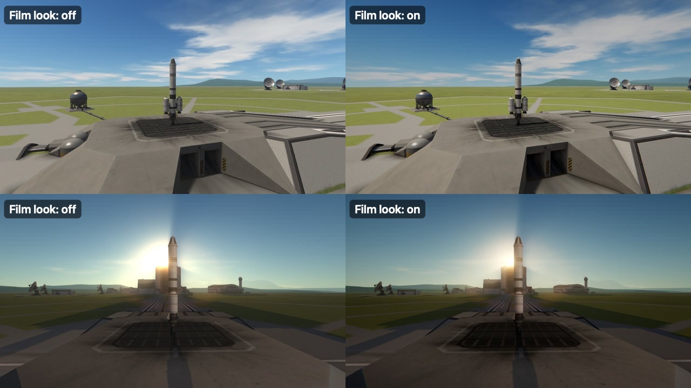

*The film look off and on, the camera's exposure held still in both: more contrast, darker creases and
corners, and a low sun that rolls over instead of washing out the sky round it.*

*Left: the game's own picture. Right: with the mod. The same moment, the same view, in every pair from
here on.*

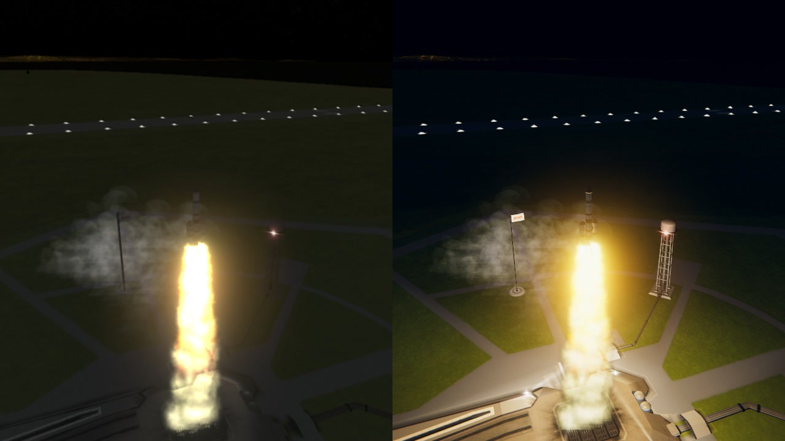

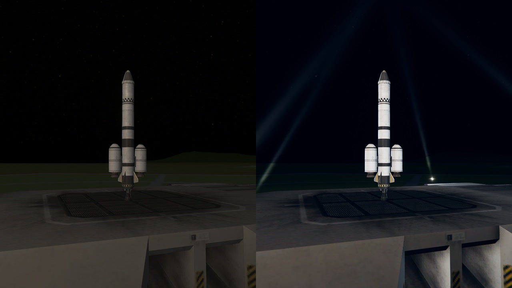

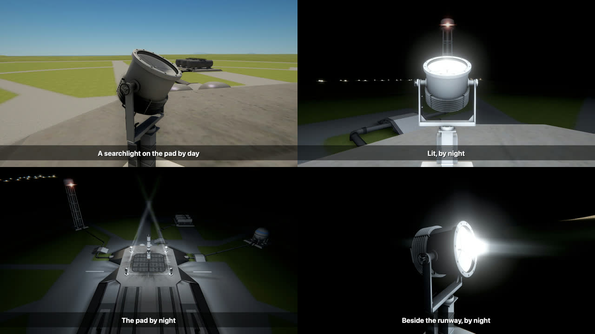

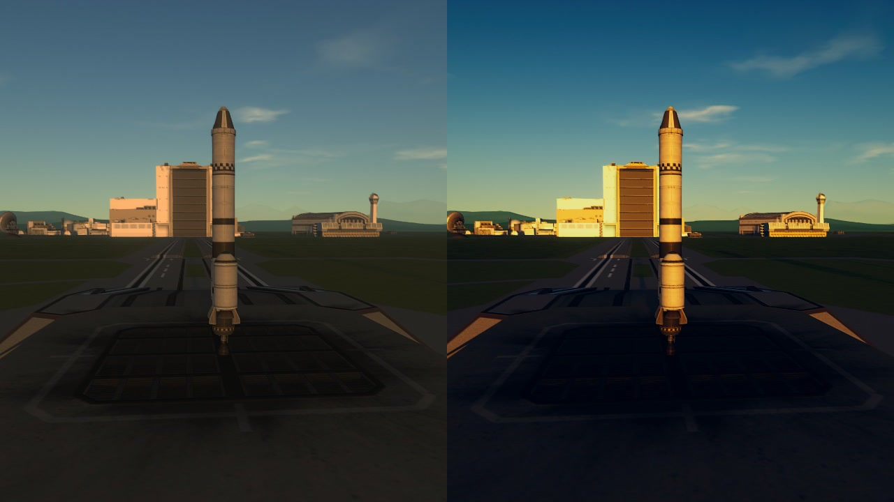

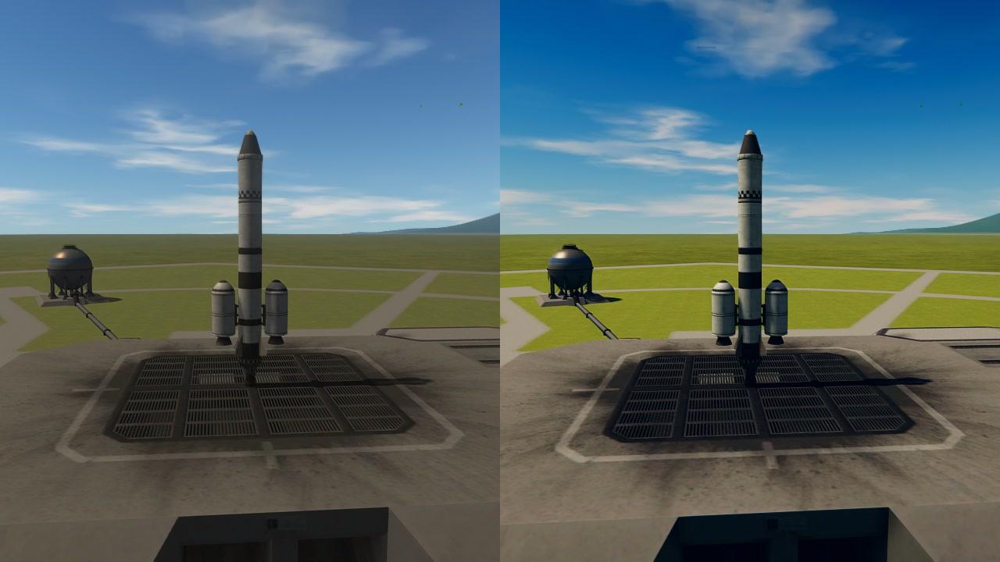

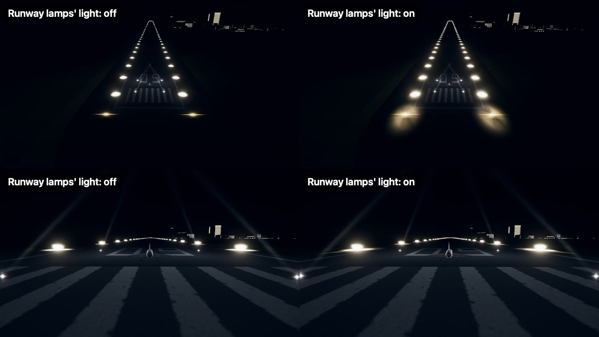

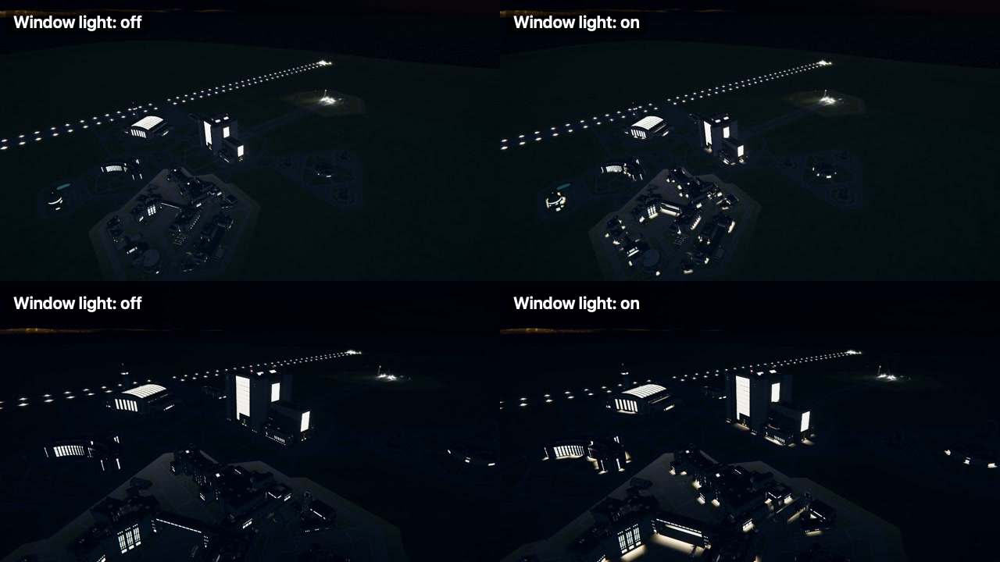

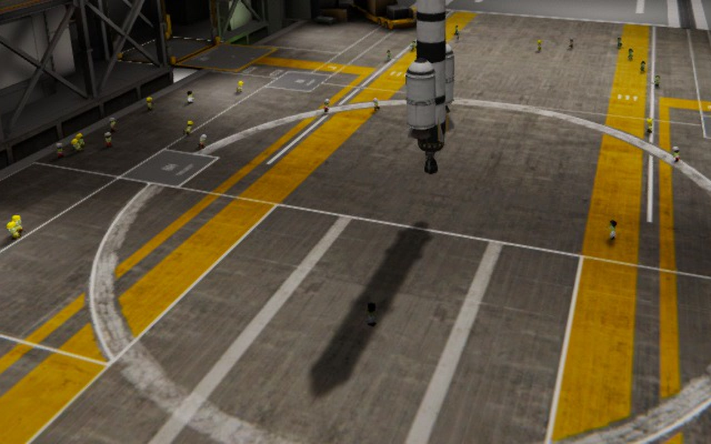

*The assembly building with the mod: the kerbal in the rocket's shadow is as dark as the floor there. The
game draws every one of them as bright as those in the light.*

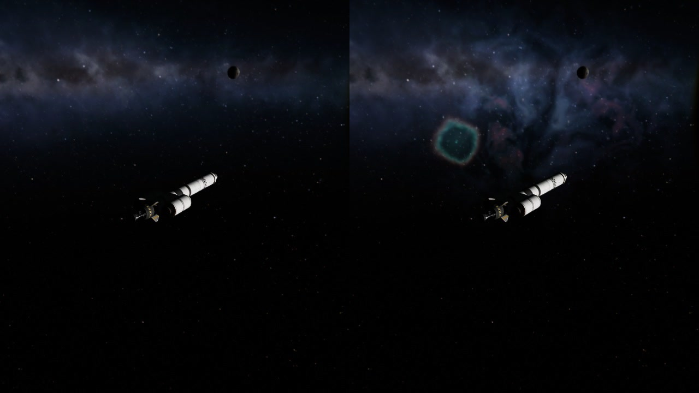

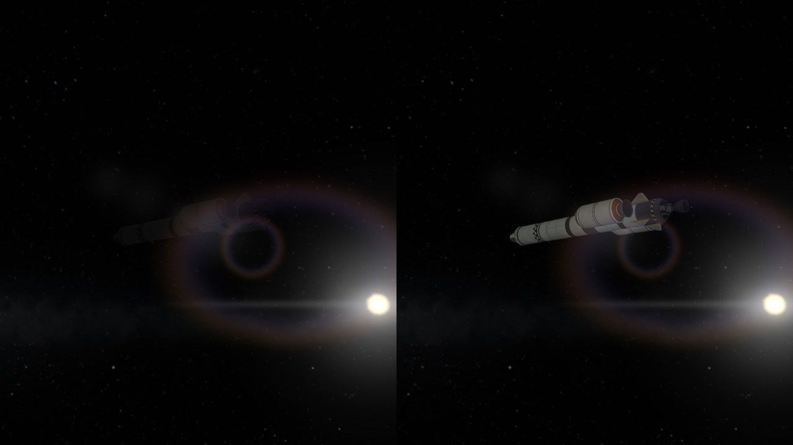

## Install

Install [Keystone](https://github.com/IshiakiZ/ksp-keystone) first: it is a download of its own, and its `Keystone` folder goes into your KSP
`GameData`. Then copy the `NaturalLight` folder from this mod's download into `GameData` beside it.
It is on as installed.

## Settings

In the Keystone window (the keystone button on the game's toolbar, or Option-K on a Mac, Alt-K elsewhere).
Each part can be turned down or off by itself; the first setting puts all of it out.
[What each one does](Settings.md).

## Good to know

* **Nights are dark**, as they are: the game keeps a quarter of full brightness at midnight, this keeps a
  twentieth, plus whatever the Mun gives. "Darkest" raises it.
* It works beside Scatterer and EVE, and leaves the dimming and reddening of a low sun to Scatterer where
  Scatterer does it. Its film look is a layer over whatever TUFX profile is in use: a profile with a film
  curve or strong colour grading of its own will be doubled, so use TUFX's default profiles or turn one
  of the two off. Do not use it together with PlanetShine or another mod that sets the game's ambient
  light, and it stands down for the Engine Lighting mod's engines if that is installed.
* Cost, measured on the pad with the frame-rate cap lifted: the lights 0.1 to 0.2 thousandths of a second
  a frame of about 15; the film look, on top of what TUFX costs already, too little to tell from the
  noise of the measurement (under 0.3); the shafts of sunlight 0.7, while the sun is in view and at no
  other time; the weather's veil too little to tell from the noise (20.1 against 20.4, in rain on the pad); the
  floodlights' searchlights about 0.5 a frame of 20 (0.2 to 0.9 in nine measurements, by night, with the twelve
  round the pad and the runway near).
* Looked at in pictures by the mod's author alone; nobody has flown a mission with it yet.
* Made and tried on a Mac, and tried on Windows (see below). All of it but three small shaders of its own
  uses nothing that belongs to one system: the shafts of sunlight, the weather's veil of the distance, and
  the blacking out of the game's few broken pixels. Those are packed for the game's OpenGL (a Mac, Linux)
  and built for Direct3D (Windows).

## Where it works

| System | |
| --- | --- |
| Mac | Made and tried here (KSP 1.12.5, OpenGL), with TUFX, Scatterer and EVE. |
| Windows | Tried on Windows 11 (KSP 1.12.5, Direct3D 11), without TUFX, Scatterer or EVE: at night the floodlights on the rocket, the runway's lamps and the light of the buildings' windows on the ground, the deep sky; at sunrise the shafts of sunlight round a rocket on the pad, by the shader built for Direct3D (`PluginData/light-windows.bundle`), and the same with the game started on OpenGL (`-force-glcore`). Then with TUFX installed, the film look (the picture's contrast and colour developed, the eye following the view, read back without waiting) with its blacking out of broken pixels in use; and with Natural Weather, the veil of rain, fog and snow. Then the engines' light (Kerbal X lit at night: the pad warm yellow round it, "Engine light: 2413 kN reaching 472 m") and the cabin following the light outside (a Mk1 pod's panel by night lit only by its own lamps and instruments, mean brightness 13; by day 106). |
| Linux | **Never run.** The shaders there are the OpenGL ones the Mac runs. |

Two things came after that trial on Windows and have been tried on the Mac only (both plain C#): where a launch
site's four searchlights stand and how their glass sits in its housing (0.10.3), and the camera's eye reading the
picture after the clouds are in it (0.10.4).

More: [how it works](How-it-works.md),
[limits](Limits.md),
[building it yourself](Building.md).
